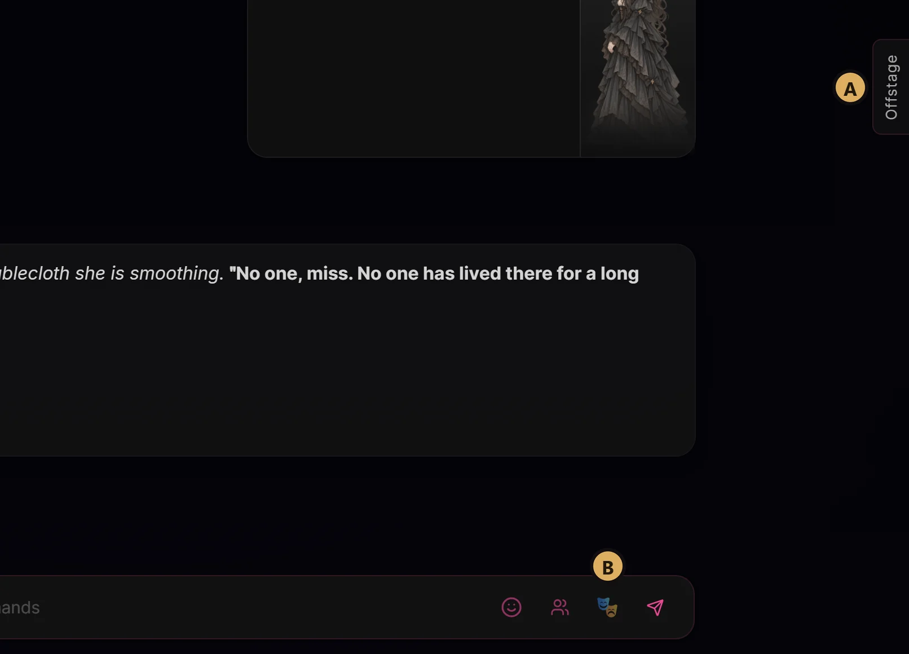
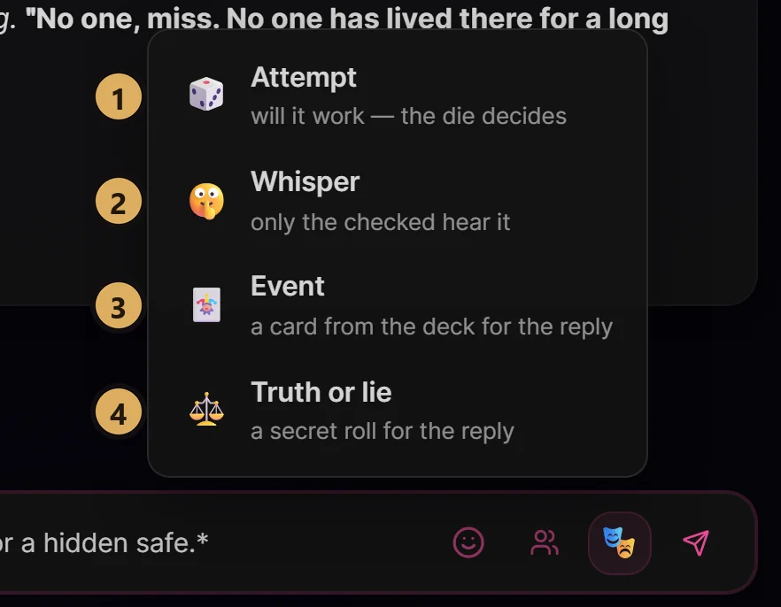
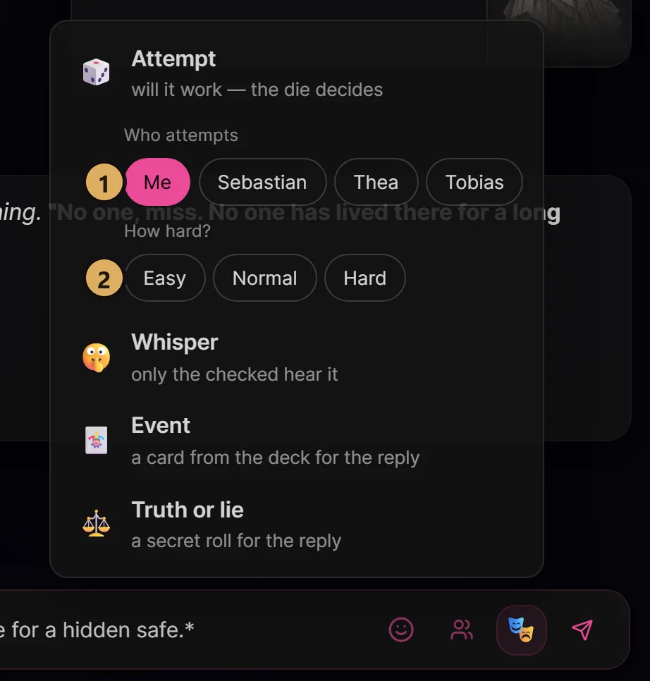
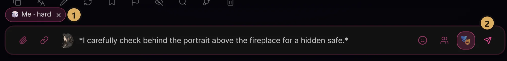
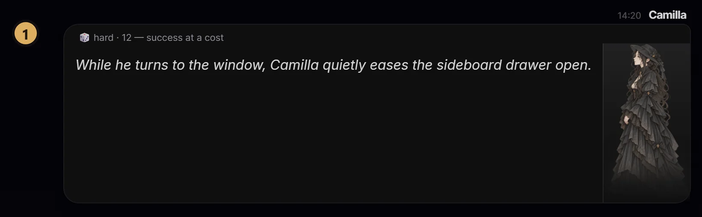
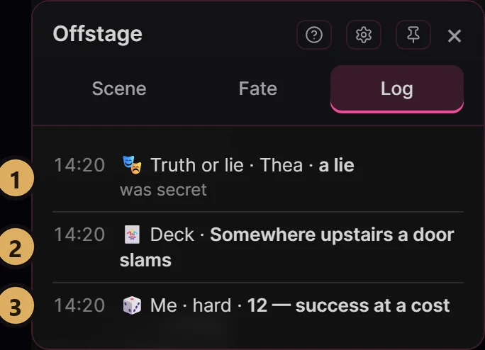
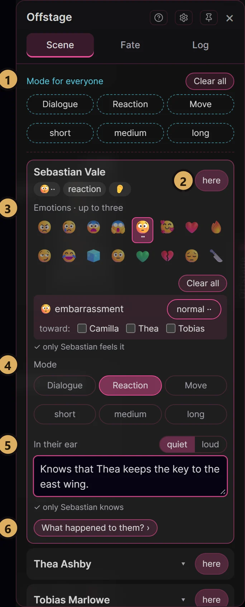
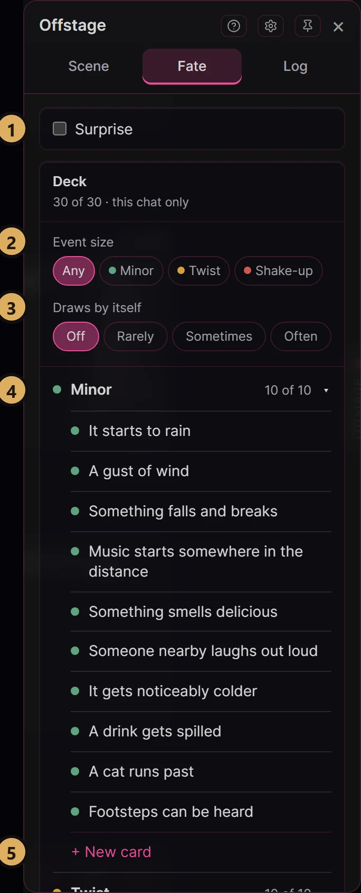
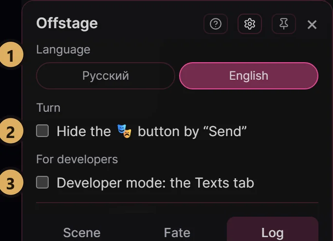
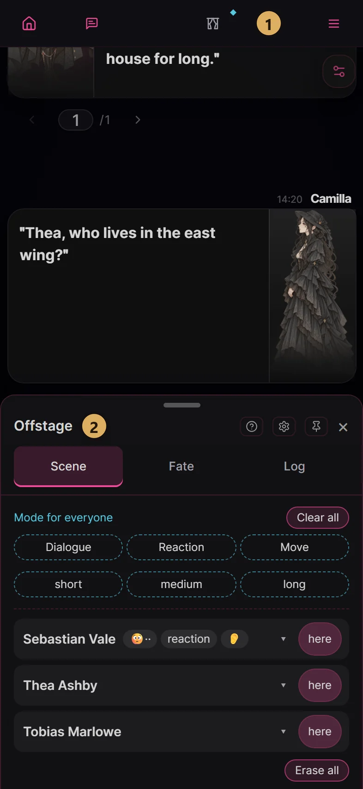

# Offstage: your first game

Offstage is a director's desk for group roleplay in Marinara Engine. You decide who hears what, how a character feels and
when chance steps in, all with buttons: no commands, no lorebook editing.

> **Before your first game.** Offstage needs a **group chat in Individual mode**: chat settings (gear) → **Group Chat** →
> **Mode** → **Individual**. In any other mode whispers and "away" don't work, and everyone hears every secret.

## Where things are

- **A. The Offstage tab** at the right edge of the chat opens the panel: who is in the room, emotions, secrets, the deck.
  These settings last until you change them.
- **B. The 🎭 button** next to Send adds something to the turn you are writing right now.

Lost? The **?** in the panel's header turns on one-line hints under every block.

## Take a turn

Write your reply as usual. Offstage only adds something to it.

**Step 1. Tap 🎭 and pick one.**

1. **Attempt**: the die decides whether it works.
2. **Whisper**: check who hears it, then write the whisper in the message box. Characters you don't check won't hear it.
3. **Event**: something from your deck happens in the reply.
4. **Truth or lie**: the answer to your next question will be the truth or a lie. Not even you know which until you look
   in the Log.

**Step 2. For an Attempt, say who and how hard.**

1. **Who attempts**: **Me** means you; write what you try as a normal reply. Or pick a character, then write what they try
   in the message box.
2. **How hard?** Easy, Normal or Hard. The die is rolled when you send.

**Step 3. Send.**

1. **The chip above the box** means it is ready for your next message. Changed your mind? Tap the **×** on the chip.
2. **Send** as usual. Offstage does the rest.

## What came up

The die and the cards reach the model as a hidden instruction, so they never appear in the chat text. You see the outcome
in the character's reply.

1. **The roll line** at the top of your message. Only you see it; the model doesn't.

The **Log** tab, newest first. Tap a secret entry to reveal it.

1. Truth or lie.
2. An event from the deck.
3. An attempt.

## The panel: Scene

Every character in the chat is here. Tap a name to open everything about them.

1. **Mode for everyone**: how everyone replies unless they have their own mode.
2. **here / away**: an away character has left the room and hears nothing new until you bring them back.
3. **Emotions**: up to three at once, each with an intensity and a target ("toward"). The character won't say "I'm
   embarrassed", but it shows in what they do.
4. **Mode**: reply with dialogue, only a reaction, or a move toward their own goal; plus the reply's length. It stays until
   you tap it again.
5. **In their ear**: what only this character knows. **quiet** keeps it in the background; **loud** makes them act on it
   now.
6. **What happened to them?** When a character comes back or first enters the scene, tap it and the model writes where
   they were (this needs a model connection). The story becomes their secret, kept in an envelope ✉ in their row: they
   won't blurt it out, but they will answer a direct question. Tap the envelope to read it or forget it.

## The panel: Fate

The event deck belongs to the game: every chat in the same folder shares it. A chat outside a folder has a deck of its
own. It starts with a starter set, so you can play right away.

1. **Surprise**: you don't see what came up until you open it in the Log.
2. **Event size**: Any, Minor, Twist or Shake-up: the size of the cards drawn in this scene.
3. **Draws by itself**: the deck slips in events on its own, rarely, sometimes or often. These cards are secret.
4. Cards by size, in three lists. Tap a heading to open it, tap a card to edit it.
5. **+ New card** adds your own card to the end of the list. For many at once, use **Paste a list** under the lists; it
   includes a ready prompt for asking an AI to write cards for you. Played all your cards? **more ⋯** → **Shuffle** under the lists
   brings them back.

## Settings ⚙

1. **Language**: Russian or English, for both the panel and the texts sent to the model.
2. **Hide the 🎭 button by "Send"** if it gets in the way. Attempt, Event and Truth or lie then live in the **Fate** tab.
3. **Developer mode**: the **Texts** tab, where you can rewrite what Offstage sends to the model. For tinkerers.

## On a phone

1. **The curtain button** in Marinara's top bar opens Offstage.
2. **The sheet**: tap its header to go full screen and back; swipe it down to close.

On a computer or an iPad, drag the panel by its header wherever you like. A tap outside closes the panel; the pin in its
header keeps it open.

## Good to know

- **Marinara's chat summary includes whispers.** If you keep secrets, don't turn on auto-summary.
- **Lorebook keywords don't know about whispers.** A keyword in a whisper can trigger the entry for characters who didn't
  hear it.
- **Everything works in Roleplay.** Conversation has no 🎭 button and no Attempt: whispers are on the **Scene** tab, Event
  and Truth or lie on the **Fate** tab.
