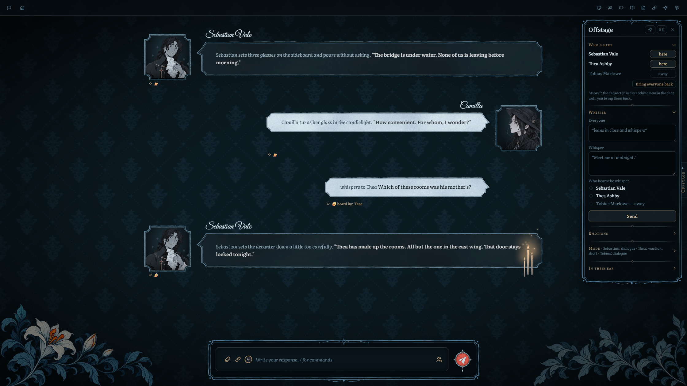
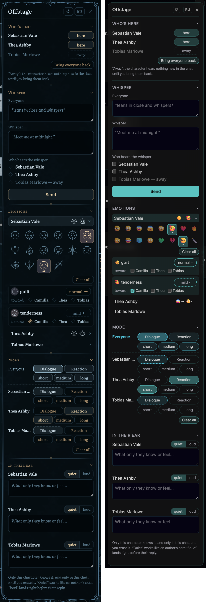
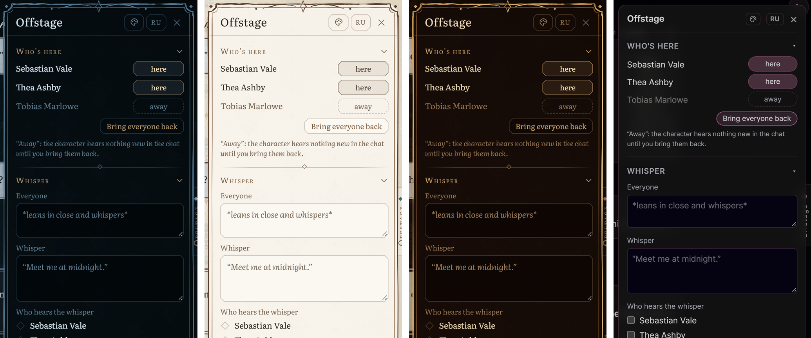
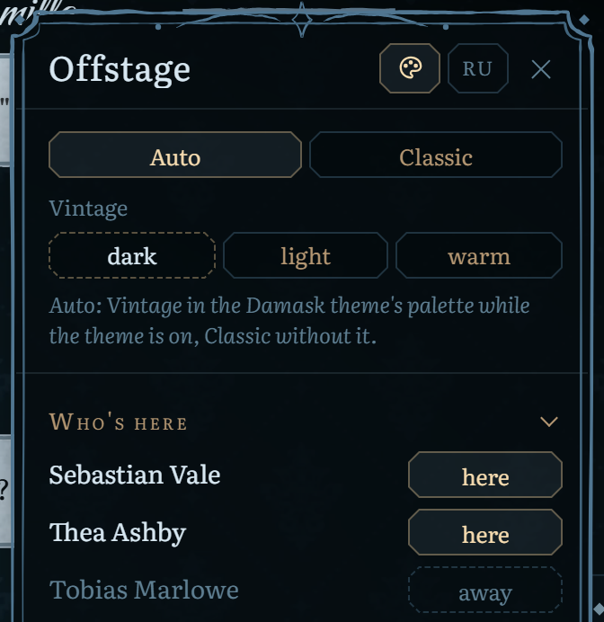
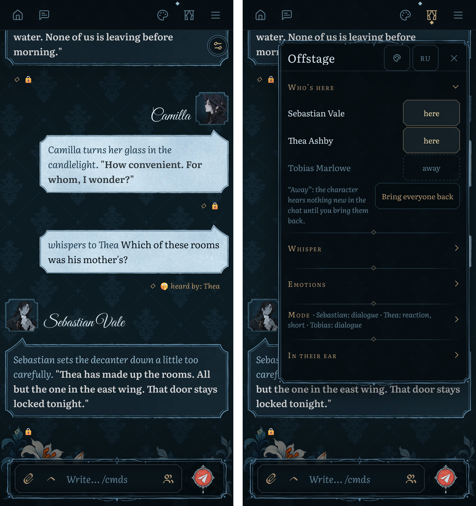

# Offstage

A side panel for **group roleplay scenes** in [Marinara Engine](https://github.com/Pasta-Devs/Marinara-Engine).
In the middle of a scene, without slash commands or digging through lorebooks, you decide
who is in the room, who hears a whisper, what a character feels, and how they answer next.



> Tested on **Marinara Engine 2.5.0**.
> The interface is in **English and Russian**; the switch is in the panel's header. По-русски: [README.ru.md](README.ru.md).

## What it does

On desktop and iPad a tab labeled **Offstage** sits on the right edge of any chat. On phones
there is a **curtain button** in Marinara's top bar instead. Either opens a floating panel with
five sections. Tap a section's heading to fold it.

**Who's here.** Each character has a *here / away* switch. While a character is away, every
new message is hidden from them. Bring them back and they hear new messages again, but what
happened without them stays hidden from them for good. **Bring everyone back** does it for
all at once.

**Whisper.** Two boxes: **Everyone** (what all characters see, e.g. *leans in close*) and
**Whisper** (what only the checked characters hear). They are sent as two messages from you;
the second is hidden from everyone who isn't checked.

**Emotions.** Sixteen emotions per character: anger, jealousy, tenderness, fear, guilt,
cruel impulse and more. Up to three at a time, each with an intensity (mild / normal / strong)
and an optional target ("jealousy → Mara"). The character receives this as a hidden
undercurrent that colors their behavior instead of being announced; they say it out loud only
when they're aware of it and ready to.

**Mode.** A per-character instruction for the next replies: **Dialogue** or **Reaction**
(silent, action only), and a length: **short / medium / long**. Set it for **Everyone** or
for one character; a personal setting wins. It stays on until you release the button.

**In their ear.** A note only one character knows, in this chat only. **Quiet** works like an
author's note; **loud** lands right before their reply.

**Markers.** Hidden messages get a small label that only you see: 🔒 hidden from those who
were away, 🤫 *heard by: …* on whispers. The model never sees the labels.



## Looks

The **palette button** in the panel's header (*Panel look*) opens a strip with the looks:

- **Auto** (the default): **Vintage** in the palette of the
  [Damask](https://github.com/RadaOgrada/Marinara-Damask) theme while the theme is on, and it
  switches when you switch the theme's palette; **Classic** without the theme.
- **Classic:** the original look, in Marinara's own colors, with your system's emoji for the
  emotions.
- **Vintage: dark / light / warm.** Hand-drawn emotion icons, a framed panel on damask paper,
  serif type. It works without the theme too.

The look you picked is highlighted; under Auto, the look Auto is showing right now has a dashed
outline. Like the language, the choice is saved once for every device that opens your Marinara.





On a phone the panel opens from the curtain button in the top bar:



## Requirements

- Marinara Engine 2.5.0.
- A **group chat** in **Individual** mode for whispers and *away*
  (chat settings → Group Chat → Mode). Emotions, mode and notes should work in one-on-one
  chats too, but group chats are where it has been tested.
- Desktop or mobile browser. On touch screens there are no hover tooltips.

## Install

Offstage is an **External Extension with full page access**, so Marinara asks you to unlock
third-party extensions first.

1. **Allow external extensions on the host.** Open the `.env` file in your Marinara folder
   (on Windows usually `%LOCALAPPDATA%\Marinara-Engine\.env`) and set
   ```
   ENABLE_EXTERNAL_EXTENSIONS=true
   ```
   Add the line if it isn't there. Restart Marinara.
2. **Allow imports in the app.** **Settings → Advanced → Danger Zone**, read the warning, turn on
   **Allow third-party extension imports** and confirm **I Understand, Enable**.
3. **Import.** Download `Offstage-0.9.1.personal-extension.zip` from
   [Releases](../../releases) (don't unzip it). **Settings → Addons → External Extensions →
   Import Extension File** and pick the zip. (**Import Extension Folder** takes this
   repository's `offstage` folder instead.)
4. **Approve.** Offstage appears disabled, marked *Needs approval · Full page access*. Press the
   power icon on its row (**Review and run**) and confirm **Run Exact Code**.
5. Open a group chat: the **Offstage** tab appears on the right (on a phone, the curtain button
   in the top bar).

Using Marinara from a phone or another computer on your network? Importing also needs admin
access: set `ADMIN_SECRET` on the server and enter the same value under
**Settings → Advanced → Admin Access**. Once installed, the panel loads in every browser that
opens your Marinara.

**Update:** import the new zip and confirm **Save Disabled Update**, then **Review and run →
Run Exact Code** again. Your settings and chats are kept. **Remove:** Disable (the power icon),
then delete it with the trash icon in External Extensions.

## Optional: give Mode the last word

By default the mode instruction is inserted into the chat history right before the reply.
If your preset has rules about length that come *after* the chat history, they come later and
can win. To make Offstage speak last, put this macro **at the very end of the last preset
section that follows the chat history**:

```
{{outlet::Offstage}}
```

The next time you open the panel or press a mode button, the mode instructions move there.
An empty outlet adds nothing to the prompt when no mode is pressed.

## Why full page access

Marinara's sandbox can't read messages, hide a message from one character, or write lorebooks
and chat metadata, so Offstage runs as page code. In short:

- **Talks only to your own Marinara.** No outside network, no analytics. The Vintage pictures
  and font are inside the extension.
- **Reads** characters, personas, the open chat and its messages, and the chat's preset (only to
  find the outlet macro).
- **Writes** the two messages of a whisper, Marinara's own "hidden from this character" flag on
  messages, a few `kulisy*` keys in chat metadata, and one lorebook per chat,
  **"In their ear — <chat name>"** (notes, emotions, mode). Other lorebooks stay untouched.
- **On the page** it adds its tab, the panel and the 🔒 / 🤫 labels. Disabling the extension
  removes all of it.
- **Remembers** your choices in its own extension storage, and folded sections in your browser.

The code is one readable file, [`offstage/extension.js`](offstage/extension.js), plus
[`offstage/extension.css`](offstage/extension.css). Please read it before approving: that's
what the approval step is for.

("Kulisy" is the panel's original Russian name, *Кулисы*, "the wings of a stage". Internal
keys keep it so older chats keep working.)

## Known limitations

- **Summaries leak secrets.** Marinara's chat summary (the button and auto-summary) includes
  every message that isn't hidden from *all* characters. Whispers and what happened while
  someone was away end up in the shared summary. If secrets matter, keep auto-summary off.
- **Lorebook keywords ignore hiding.** Keyword scanning reads the latest messages as a whole:
  if a whisper contains a keyword, that entry fires for characters who didn't hear it.
  Per-character entry filters still work.
- **A short window when someone leaves.** New messages are hidden from absent characters
  0.2–2 seconds after they appear. If you trigger an absent character's reply in that moment,
  they may see the newest message.
- **The panel uses Marinara's internals:** message bubble classes, the React Query cache,
  `/api` routes. A Marinara update can break it. If it does, disable it and open an issue.
- **Deleting a chat doesn't delete its "In their ear" lorebook.** Remove it by hand in
  Lorebooks.
- **Switching the language** rewrites the text of the open chat's emotion and mode entries;
  other chats follow when you open them. Lorebook and entry *names* keep the language they
  were created in (the panel recognizes both). Free-text notes stay as you wrote them.
- **English instructions were tested lightly.** The mode texts were tuned on Russian roleplay
  and checked in English on DeepSeek V3. Different models obey length rules differently.

## Language

On first run the panel picks Russian if your browser is set to Russian, English otherwise, and
remembers it. The **RU / EN** button in the header switches it for every device that opens
your Marinara.

## License

- **Code:** [MIT](LICENSE).
- **Classic** uses your system's own emoji.
- **Font:** Literata (The Literata Project Authors), SIL Open Font License,
  [`offstage/OFL-Literata.txt`](offstage/OFL-Literata.txt).

`LICENSE` and `OFL-Literata.txt` are inside the release zip too.
