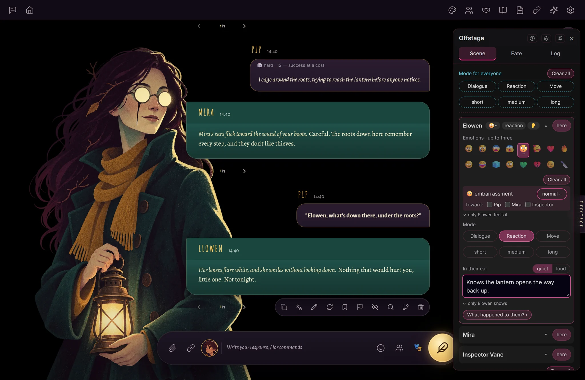
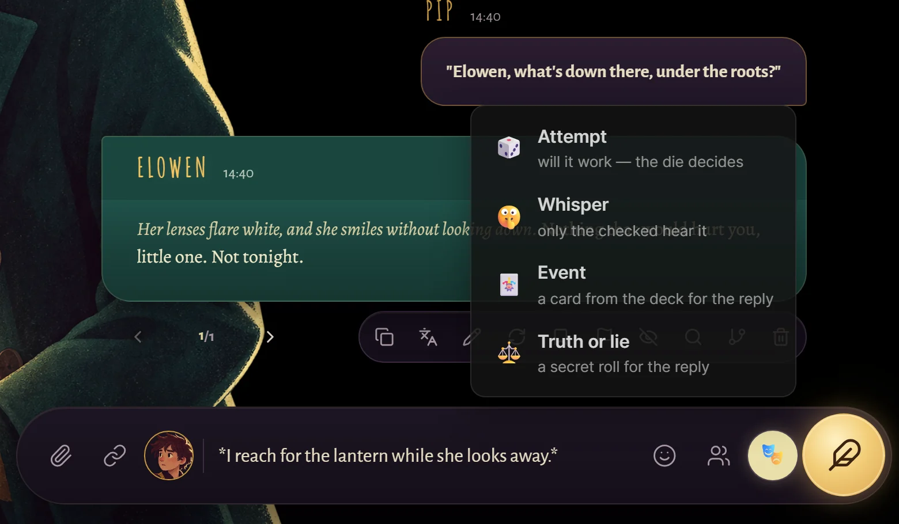
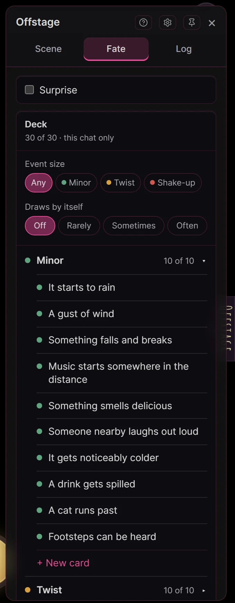
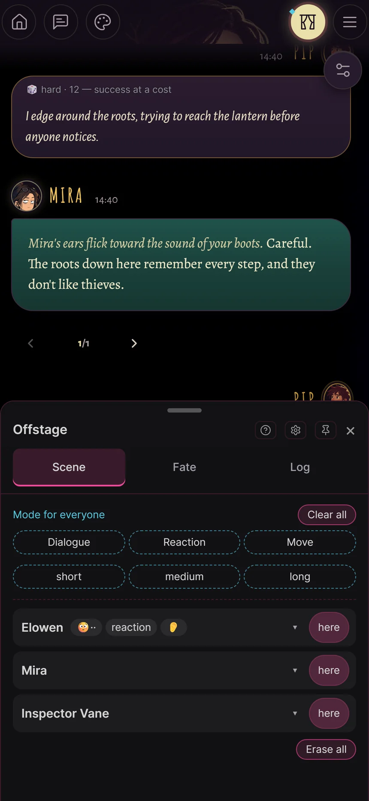

# Offstage 2

A director's desk for **group roleplay** in [Marinara Engine](https://github.com/Pasta-Devs/Marinara-Engine).
With buttons only (no slash commands, no lorebook editing) you decide who is in the room, who hears a whisper, what a
character feels and how they answer, and when chance steps in: a die, a card from your own event deck, a secret truth
or lie.



> Tested on **Marinara Engine 2.5.0**. The interface is in **English and Russian**.
> New to it? **[Your first game](GUIDE.md)**: a short illustrated walkthrough. По-русски: [README.ru.md](README.ru.md).
>
> The screenshots show the Forest style of [Frontispiece](https://github.com/RadaOgrada/Frontispiece), another
> extension of mine. Offstage itself uses Marinara's native look and works with any theme.

## What's new in 2

- **The 🎭 button next to Send**: an **Attempt**, a **Whisper**, an **Event** or **Truth or lie** for the turn you write.
- **One panel with tabs**: Scene · Fate · Log.
- **An event deck** per game, cards by size; it can draw by itself.
- **Life offstage**: when a character comes back or first enters, the model writes where they were, as their secret.
- **Entering a scene**: a newcomer doesn't know what happened before they came in.
- **Move** mode, **several people in one character card**, **developer mode** with your own texts for the model.
- One look, Marinara's own. The Vintage look is gone: fewer things to break.

## What it does

### The 🎭 button: this turn



Pick one, write your reply as usual and press **Send**. Your pick waits as a chip above the message box; **×** on the
chip takes it back.

- **Attempt.** Who tries (**Me** or a character) and how hard: Easy, Normal, Hard. A d20 is rolled on send: success,
  success at a cost, or failure, and the reply plays exactly that. A regenerate keeps the outcome. Only you see the roll
  line under your message.
- **Whisper.** Check who hears it and write it in the message box. Characters you didn't check never see it. You can
  add a line everyone sees ("leans in close").
- **Event.** Up to three unplayed cards of the scene's size go to the model; it plays the one that fits, the rest don't
  happen.
- **Truth or lie.** The answer to your next question is the truth or a lie, 50/50, decided in secret. The Log shows which.

All of it reaches the model as a hidden instruction (Marinara's own Guide). Nothing is written into the chat text.

### Scene tab: who's here and how they feel

- **here / away.** Every new message is hidden from an away character. Back again, they hear new messages; what happened
  without them stays hidden. **Bring everyone back** does it at once.
- **Emotions.** Sixteen, up to three at a time, each with an intensity and a target ("jealousy → Mara"). They show in
  what the character does; the character doesn't announce them.
- **Mode.** **Dialogue**, **Reaction** (silent, action only) or **Move** (a step toward their own goal), plus a length:
  short / medium / long. For **everyone** or one character; a personal setting wins. It stays until you tap it again.
- **In their ear.** A note only this character knows, in this chat. **Quiet** works like an author's note; **loud**
  makes them act on it now.
- **What happened to them?** When a character comes back from "away" or first enters, tap it: the model writes a short
  story of where they were (how long, what kind, how big, an optional hint). It becomes their secret, an envelope ✉ in
  their row: they won't blurt it out but answer a direct question from it. Tap the envelope to read it or **Forget** it.
  For a character entering the scene, the model also writes how they come in.
- **Entering a scene.** A character who joins a running chat gets Marinara's own **New start** mark on the last message
  before them: everything above stays out of their prompt. A returning character sees only the latest message of what
  they missed. **Individual** mode only.

### Fate tab: the deck



- **The deck belongs to the game:** every chat in the same folder shares it (a chat outside a folder has its own). It
  starts with 30 cards, so you can play right away.
- **Event size** for this scene: Any, Minor, Twist or Shake-up. Cards sit in three lists by size: tap a heading to open
  it, a card to edit it, **+ New card** to add one.
- **Paste a list** adds many at once, with a ready prompt for asking an AI to write cards. **more ⋯** under the lists:
  **Shuffle** brings played cards back; **Remove all cards**.
- **Draws by itself:** rarely, sometimes or often the deck slips in an event on its own. Those cards are secret.
- **Surprise** at the top: outcomes show only in the reply and in the Log, until you open them there.
- Without the 🎭 button (⚙ → **Hide the 🎭 button**), Attempt, Event and Truth or lie live in this tab.

The **Log** tab lists rolls, cards and truth-or-lie answers, newest first. Tap a secret entry to reveal it.

### Settings ⚙ and developer mode

- **Language**: Russian or English, for the panel and for the texts sent to the model.
- **Developer mode** adds the **Texts** tab, where you rewrite what Offstage sends to the model, in groups (Attempt,
  Event, Truth or lie, Mode, Offscreen).
  - **Save** / **Restore the original**. Edited texts carry a dot. A text missing one of its `{slots}` won't save.
  - Your texts are kept on the server, for every device and every chat. **Download** / **Upload** saves them as one
    file: a backup, or a set to share.
  - If a newer Offstage changes an original you edited, the text is marked.
  - Tip: a rule like "the reply starts with the word X" is followed in the character's first line of speech, not the
    very first word.

### Several people in one card

A card with headings `[CHARACTER: Name]` in its description (the rule of Marinara's own tracker) shows each person as
an indented row under it, with their own emotions, mode and notes. **here / away** and whispers apply to the whole
card: Marinara hides a message from the whole card.

### Phone, computer, iPad



- **Phone:** the **curtain button** in Marinara's top bar opens the panel as a bottom sheet. Tap its header for full
  screen, swipe down to close.
- **Computer or iPad:** a tab on the right edge of the chat. Drag the panel by its header anywhere; a tap outside
  closes it, the **pin** in its header keeps it open.

## Requirements

- Marinara Engine 2.5.0.
- A **group chat** in **Individual** mode (chat settings → Group Chat → Mode). In Merged mode, Marinara's default,
  every character sees every whisper and secret.
- **Roleplay** mode for the 🎭 button and Attempt. In **Conversation**, whispers are on the Scene tab, Event and Truth or
  lie on the Fate tab.
- A model connection for **What happened to them?** (one extra request per story).
- Desktop or mobile browser. Touch screens have no hover tooltips; the **?** in the header shows one-line hints instead.

## Install

Offstage is an **External Extension with full page access**, so Marinara asks you to unlock
third-party extensions first.

1. **Allow external extensions on the host.** Open the `.env` file in your Marinara folder
   (on Windows usually `%LOCALAPPDATA%\Marinara-Engine\.env`) and set
   ```
   ENABLE_EXTERNAL_EXTENSIONS=true
   ```
   Add the line if it isn't there. Restart Marinara.
2. **Allow imports in the app.** **Settings → Advanced → Danger Zone**, read the warning, turn on
   **Allow third-party extension imports** and confirm **I Understand, Enable**.
3. **Import.** Download `Offstage-2.0.0.personal-extension.zip` from
   [Releases](../../releases) (don't unzip it). **Settings → Addons → External Extensions →
   Import Extension File** and pick the zip. (**Import Extension Folder** takes this
   repository's `offstage` folder instead.)
4. **Approve.** Offstage appears disabled, marked *Needs approval · Full page access*. Press the
   power icon on its row (**Review and run**) and confirm **Run Exact Code**.
5. Open a group chat: the **Offstage** tab appears on the right (on a phone, the curtain button
   in the top bar), and the 🎭 button next to Send.

Using Marinara from a phone or another computer on your network? Importing also needs admin
access: set `ADMIN_SECRET` on the server and enter the same value under
**Settings → Advanced → Admin Access**. Once installed, the panel loads in every browser that
opens your Marinara.

**Update from 0.9:** import the new zip and confirm **Save Disabled Update**, then **Review and
run → Run Exact Code** again. Emotions, modes, notes, whispers and your chats are kept; the Vintage look quietly
becomes the native one.

**Remove:** Disable (the power icon), then delete it with the trash icon in External Extensions.

## Optional: give Mode the last word

The mode instruction goes into the chat history right before the reply. Length rules in your preset that come *after*
the chat history can override it. To make Offstage speak last, put this macro **at the very end of the last preset
section that follows the chat history**:

```
{{outlet::Offstage}}
```

The mode instructions move there the next time you open the panel or press a mode button. With no mode pressed, the
empty outlet adds nothing.

## Where secrets live

- **Whispers and "away"**: Marinara's own flag on each message, "hidden from this character".
- **In their ear, emotions and modes**: one lorebook per chat, **"In their ear — <chat>"**; each entry reaches only its
  own character.
- **Life offstage stories** belong to the game, like the deck: one lorebook **"Secrets — <folder>"**, shared by every
  chat in folders of that name, so stories carry over to a new chat of the same game. Each story reaches only its
  character. In your lorebook list that book is a list of spoilers: open it only if you want to know.
- Marinara's lorebook budget is 8192 tokens per chat in total. Old secrets crowd it: forget the ones that no longer
  matter.
- Keeping a secret until asked was tested on DeepSeek V3; other models may be looser.

## Why full page access

Marinara's sandbox can't read messages, hide a message from one character, or write lorebooks and chat metadata, so
Offstage runs as page code.

- **Talks only to your own Marinara.** No outside network, no analytics. Stories for "What happened to them?" go
  through Marinara's own generation with the chat's connection.
- **Reads** characters, personas, the open chat and its messages, and the chat's preset (only to find the outlet macro).
- **Writes** the messages of a whisper; Marinara's "hidden from this character" flag and New start mark on messages;
  its notes in the message's `extra` (rolls, cards); a few `kulisy*` keys in chat metadata; the lorebooks
  "In their ear — <chat>" and "Secrets — <folder>"; and a hidden Guide instruction in the next generation request when
  you picked an attempt, an event or truth or lie. Other lorebooks stay untouched.
- **On the page** it adds its tab, the panel, the 🎭 button, chips and the 🔒 / 🤫 / 🎲 labels. Disabling the extension
  removes all of it.
- **Remembers** decks, secrets, your texts and settings in its own extension storage on the server; folded lists and
  the panel's place in your browser.

The code is one readable file, [`offstage/extension.js`](offstage/extension.js), plus
[`offstage/extension.css`](offstage/extension.css). Please read it before approving: that's what the approval step is
for.

("Kulisy" is the panel's original Russian name, *Кулисы*, "the wings of a stage". Internal keys keep it so older chats
keep working.)

## Known limitations

- **Summaries leak secrets.** Marinara's chat summary (the button and auto-summary) includes every message that isn't
  hidden from *all* characters, so whispers and what happened while someone was away end up in it. If secrets matter,
  keep auto-summary off.
- **Lorebook keywords ignore hiding.** Keyword scanning reads the latest messages as a whole: a keyword in a whisper
  fires its entry for characters who didn't hear it. Per-character entry filters still work.
- **Marinara's agents see every secret.** Built-in agents (Narrative Director, Secret Plot and others) get the whole
  lorebook scan without the per-character filter, "In their ear" and life offstage included. No agents in the chat, no
  problem.
- **A short window when someone leaves.** New messages are hidden from absent characters 0.2–2 seconds after they
  appear. Trigger an absent character's reply in that moment and they may see the newest message.
- **Storage:** up to 150 cards per deck. All decks and secret indexes of all games share the extension's 1 MB of
  storage (about 20 full decks).
- **Renaming a folder** leaves its deck and secrets under the old name: rename it back to get them.
- **It uses Marinara's internals:** message bubble classes, the React Query cache, `/api` routes. A Marinara update can
  break it. If it does, disable it and open an issue.
- **Deleting a chat doesn't delete its "In their ear" lorebook.** Remove it by hand in Lorebooks.
- **Switching the language** rewrites the open chat's emotion and mode entries; other chats follow when you open them.
  Lorebook and entry *names* keep the language they were created in (the panel recognizes both). Free-text notes stay
  as you wrote them.
- **Tested on DeepSeek V3** (and partly MiMo 2.5 Pro), mostly in Russian roleplay. Models differ in how they obey length
  rules and keep secrets.

## Language

On first run the panel picks Russian if your browser is set to Russian, English otherwise. Switch it in ⚙; the choice
holds for every device that opens your Marinara.

## License

**Code:** [MIT](LICENSE); `LICENSE` is inside the release zip too. Emoji are your system's own.
