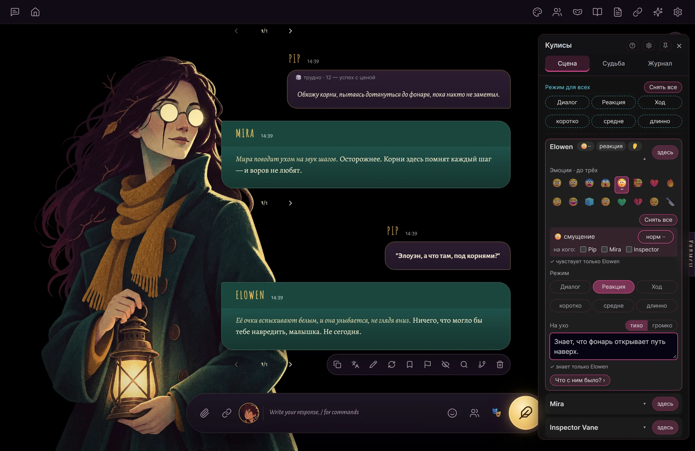

# Кулисы 2 (Offstage)

Режиссёрский пульт для **групповых ролевых игр** в [Marinara Engine](https://github.com/Pasta-Devs/Marinara-Engine).
Одними кнопками, без команд и без захода в лорбук: кто в комнате, кто слышит шёпот, что персонаж чувствует и как
ответит, и когда вмешивается случай: кубик, карта из своей колоды событий, тайная правда или ложь.

> Проверено на **Marinara Engine 2.5.0**. Интерфейс русский и английский. Подробное описание, установка с пояснениями
> и полный список ограничений в [README на английском](README.md); пошаговая памятка с картинками в
> [GUIDE.md](GUIDE.md) (по-английски).
>
> На снимках стиль «Лес» темы [Frontispiece](https://github.com/RadaOgrada/Frontispiece), другого моего расширения.
> Сами Кулисы выглядят как родная маринара и работают с любой темой.

## Что нового во второй версии

- **Кнопка 🎭 у «Отправить»**: **Попытка**, **Шёпот**, **Событие** или **Правда или ложь** к ходу, который ты пишешь.
- **Одна панель с вкладками**: Сцена · Судьба · Журнал.
- **Колода событий** у игры, карты по силе; может тянуть сама.
- **Жизнь за кадром:** вернулся персонаж или вошёл впервые: модель пишет, где он был, и это его тайна.
- **Входит в сцену:** новичок не знает, что было до него.
- Режим **«Ход»**, **несколько людей в одной карточке**, **режим разработчика** со своими текстами для модели.
- Один вид, родной маринары. «Винтаж» убран: меньше поводов сломаться.

## Что умеет

**Кнопка 🎭: этот ход.** Выбери, напиши реплику как обычно и нажми «Отправить». Выбранное ждёт плашкой над полем,
«×» на плашке снимает.

- **Попытка.** Кто пытается («Я» или персонаж) и насколько трудно. d20 бросается при отправке: успех, успех с ценой
  или провал, и ответ играет ровно этот исход. Перегенерация исход сохраняет. Строчку броска видишь только ты.
- **Шёпот.** Отметь, кто слышит, и напиши шёпот в поле. Неотмеченные его не увидят.
- **Событие.** До трёх несыгранных карт силы сцены уходят модели; она играет подходящую, остальных не случается.
- **Правда или ложь.** Ответ на твой следующий вопрос будет правдой или ложью, 50 на 50, тайно. Что выпало, видно в
  Журнале.

Всё уходит модели скрытой подсказкой (Guide маринары), в текст чата ничего не пишется.

**Вкладка «Сцена».**

- **Здесь / не здесь.** Пока персонажа нет, всё новое от него скрыто. Вернулся: слышит снова, а пропущенное так и
  остаётся скрытым.
- **Эмоции.** 16 эмоций, до трёх сразу, с силой и «на кого». Видны в поведении персонажа, вслух он их не объявляет.
- **Режим.** «Диалог / Реакция / Ход» (шаг к своей цели) и длина «коротко / средне / длинно», всем или одному; личная
  настройка важнее. Держится, пока не нажмёшь ещё раз.
- **На ухо.** То, что знает только этот персонаж и только в этом чате. «Тихо» работает как заметка автора, «громко»
  заставляет действовать сейчас.
- **«Что с ним было?»** Вернулся из «не здесь» или вошёл впервые: нажми, и модель напишет, где он был (а для входящего
  ещё и как он входит). История становится его тайной в конверте ✉: сам не выболтает, на прямой вопрос ответит. Тап по
  конверту: прочитать или «Забыть».
- **Входит в сцену.** Новичку маринара сама ставит метку «Новое начало», и прошлое чата в его промпт не идёт.
  Вернувшийся видит только последнее сообщение из пропущенного. Только в режиме Individual.

**Вкладка «Судьба»: колода.**

- Колода у игры: её делят все чаты одной папки (у чата вне папки своя). Сразу есть 30 стартовых карт.
- Сила событий: Любая, Мелочь, Поворот, Встряска. Карты лежат в трёх списках, «+ Новая карта» в конце списка.
- «Вставить списком» добавляет много сразу, с готовой просьбой для ИИ. Под списками можно перемешать колоду (сыгранные
  карты вернутся) или убрать все карты.
- «Тянет сама»: редко, иногда или часто. Такие карты тайные.
- «Сюрприз»: исход видно только в ответе и в Журнале.
- Без кнопки 🎭 (⚙) Попытка, Событие и Правда или ложь живут здесь.

**Вкладка «Журнал»**: броски, карты и ответы «правда или ложь», новые сверху. Тап по тайной записи открывает её.

**⚙ и режим разработчика.** Язык панели и текстов для модели: при первом запуске берётся из браузера, держится для всех
устройств. Режим разработчика добавляет вкладку **«Тексты»**: правка всего, что Кулисы шлют модели, по группам
(Попытка · Событие · Правда или ложь · Режим · За кадром).

- «Сохранить» / «Вернуть исходный». У изменённого текста точка; без своих слотов в `{скобках}` текст не сохранится.
- Тексты хранятся на сервере, для всех устройств и чатов. «Скачать / Загрузить» сохраняет набор файлом: держать копию
  или делиться.
- Если новая версия Кулис поменяет исходный текст, который у тебя изменён, он будет помечен.
- Совет: правило «ответ начинается со слова X» модель исполняет в первой реплике персонажа, а не в первом слове ответа.

**Несколько людей в одной карточке** (заголовки `[CHARACTER: Имя]` в описании, правило трекера маринары): каждый
своей строкой под карточкой, со своими эмоциями, режимом и «На ухо». «Здесь / не здесь» и шёпот действуют на всю
карточку.

**Телефон:** кнопка-занавес в верхней полосе маринары открывает шторку снизу. **Компьютер и айпад:** язычок у правого
края; панель тащится за шапку, кнопка-булавка держит её открытой.

## Что нужно

- Групповой чат в режиме **Individual** (шестерёнка чата → Group Chat → Mode). В Merged (умолчание маринары) шёпот и
  тайны видят все.
- Кнопка 🎭 и Попытка работают только в **Roleplay**. В Conversation шёпот на «Сцене», Событие и Правда или ложь в
  «Судьбе».
- Подключение к модели для «Что с ним было?» (каждая история отдельный запрос).
- На сенсорных экранах нет всплывающих подсказок: «?» в шапке панели включает короткие подсказки.

## Как поставить

1. В файле `.env` в папке маринары (на Windows обычно `%LOCALAPPDATA%\Marinara-Engine\.env`)
   поставь `ENABLE_EXTERNAL_EXTENSIONS=true` (нет строки — допиши) и перезапусти маринару.
2. **Settings → Advanced → Danger Zone** → включи **Allow third-party extension imports** →
   **I Understand, Enable**.
3. Скачай `Offstage-2.0.0.personal-extension.zip` из [Releases](../../releases),
   не распаковывай. **Settings → Addons → External Extensions → Import Extension File** →
   выбери архив.
4. Кнопка питания в строке Offstage (*Needs approval · Full page access*) → **Review and run** →
   **Run Exact Code**.
5. В групповом чате справа появится язычок **Кулисы** (на телефоне — кнопка-занавес в верхней полосе), у «Отправить» —
   кнопка 🎭.

С телефона или с другого компьютера импорт требует ещё `ADMIN_SECRET` на сервере и то же
значение в **Settings → Advanced → Admin Access**.

**Обновление с 0.9** — так же: импорт нового архива → **Save Disabled Update** → **Review and run** →
**Run Exact Code**. Эмоции, режимы, записки, шёпот и чаты сохраняются; «Винтаж» молча сменится родным видом.

**Удалить:** Disable (кнопка питания), потом значок корзины в External Extensions.

**Чтобы «Режим» звучал последним**, допиши в самый конец последней секции пресета, которая
идёт после истории чата: `{{outlet::Offstage}}` (или `{{outlet::Режим}}`).

## Где живут тайны

- Шёпот и «не здесь»: родная пометка маринары на сообщении «скрыто от этого персонажа».
- «На ухо», эмоции и режим: статьи лорбука чата «На ухо — <чат>», каждая доходит только до своего персонажа.
- Истории «Что с ним было?» у игры, как колода: лорбук «Тайны — <папка>», общий для чатов папки, поэтому они
  переезжают в новый чат той же игры. Эта книга в списке лорбуков состоит из спойлеров.
- Общий лимит лорбуков на чат у маринары 8192 токена: старые тайны, которые уже не важны, лучше забывать.
- Как модель держит тайну до вопроса, проверено на DeepSeek V3; другие модели могут быть болтливее.

## Важно знать

- Пересказ чата маринары (кнопка и автопересказ) берёт и шёпот, и то, что было «не здесь»: в общем пересказе это
  узнают все. Держишь тайны, не включай автопересказ.
- Ключи лорбука не знают про шёпот: слово-ключ из шёпота сработает и у тех, кто не слышал.
- Агенты маринары (Narrative Director, Secret Plot и другие) видят все тайны и «На ухо». Без агентов в чате это неважно.
- До 150 карт в колоде; все колоды и тайны всех игр делят хранилище расширения в 1 МБ (≈ 20 полных колод).
- Переименуешь папку, и колода с тайнами останется под старым именем: верни имя, и они найдутся.
- Панель опирается на внутренности маринары и после её обновления может сломаться.
- Удаление чата не удаляет его лорбук «На ухо»: удаляй руками.

Остальные ограничения (короткое окно при уходе персонажа, смена языка, на каких моделях проверено) — в
[английском README](README.md#known-limitations). Там же — [почему нужен полный доступ к странице](README.md#why-full-page-access)
и что именно Кулисы трогают.

## Лицензия

Код под [MIT](LICENSE), файл лицензии лежит и в архиве. Эмодзи системные.
